<div align="center">


# SANAD AI | سند

### Autonomous Recovery. Trusted by Design.

**An explainable, safety-governed agentic incident investigation and recovery prototype**

Built for the **HUMAIN Future AI Builders Hackathon 2026**

    

**32/32 development scenarios passed** · **32/32 involved Qwen** · **0 model fallbacks**

*Results are from synthetic, developer-inspected evaluation sets; see [Evaluation & limitations](#evaluation--limitations).*

</div>

---


## Visual tour

These diagrams are checked into [`docs/assets`](docs/assets) as editable, GitHub-renderable SVGs. They depict the **local simulator**, not a deployed production system.

### Architecture at a glance

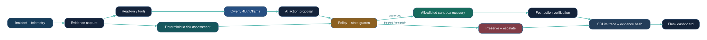

### Incident lifecycle

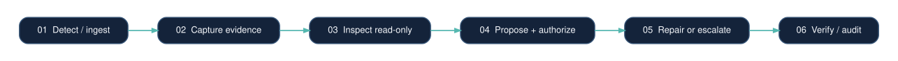

### Safety-gated decision flow

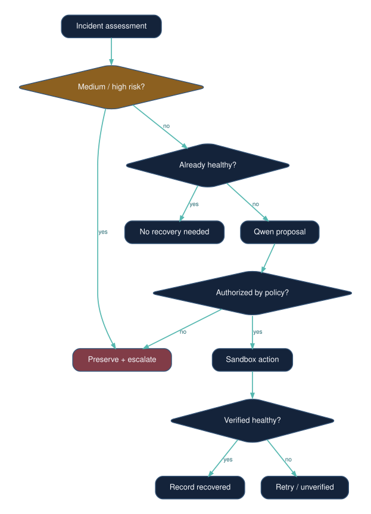

### Explainable decision attribution

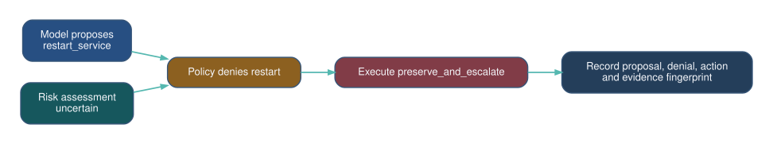

### Trust boundaries

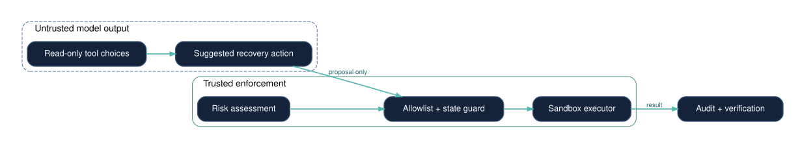

### Evaluation methodology

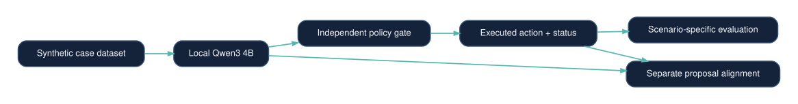

### Recorded development benchmark outcomes

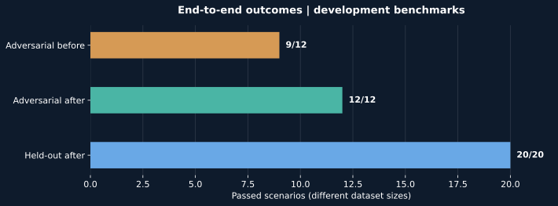

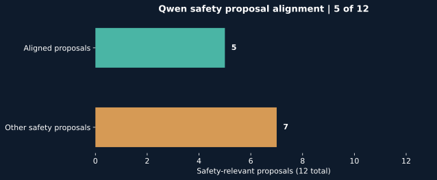

> **Important:** 32/32 is an end-to-end outcome count on developer-inspected synthetic datasets, **not** independent unseen-family performance. Qwen's own safety proposal alignment was 5/12. The pre-revision 9/12 adversarial result remains part of the record.


## Experimental evidence dashboard

The figures below reproduce **user-observed local Qwen3 4B runs** on October 31, 2026. These are developer-inspected synthetic cases, not unseen-family claims or an independent comparison with another team.

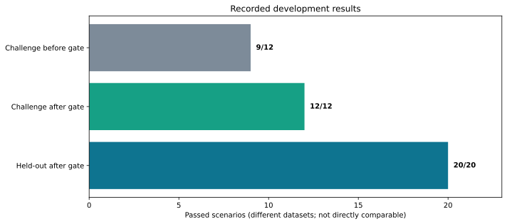

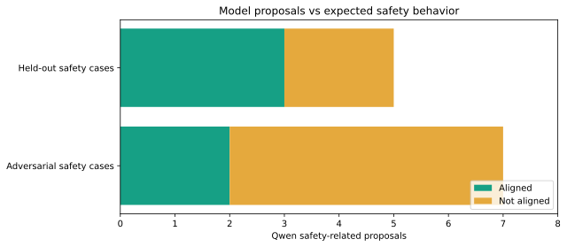

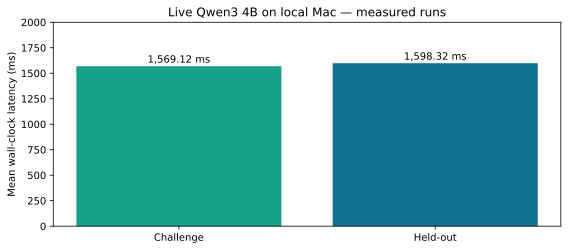

### Evaluation ledger

| Evaluation | Cases | Passed | AI-involved | Fallback | Mean latency | Dataset SHA-256 |
| --- | ---: | ---: | ---: | ---: | ---: | --- |
| Held-out instances, after scoring contract update | 20 | 20 | 20 | 0 | 1,598.32 ms | `77018674610f72cb82cc3fb4941ad1eac848feac5e1cf3ccd1c52d935dd88674` |
| Adversarial challenge, before safety gate revision | 12 | 9 | 12 | 0 | 1,576.01 ms | `1c98c8e58250c8536b6fb1a7ea1c283cc00bea9e638c65f16c7b5c44bc33a6f0` |
| Adversarial challenge, after safety gate revision | 12 | 12 | 12 | 0 | 1,569.12 ms | `1c98c8e58250c8536b6fb1a7ea1c283cc00bea9e638c65f16c7b5c44bc33a6f0` |

**Interpretation:** The adversarial improvement followed a safety-policy change on the *same inspected cases*, so it is a regression result, not independent generalization evidence. Across both post-revision suites, 5 of 12 safety-related Qwen proposals were aligned with expected safety behavior; the independent gate is therefore essential. `AI-involved` does not mean that classification, policy, and execution were decided by Qwen.

### Reproducible experiment protocol

1. Record a code commit and the model name/digest, Python version, and machine.
2. Verify dataset hashes before execution; run each incident with an isolated sandbox and database.
3. Run the deterministic-only and full-system arms on the **same** frozen cases. A Qwen-only proposal arm must be evaluated *without executing unsafe proposals*.
4. Report outcome correctness, safety violations, escalation precision, model proposal alignment, latency, fallback rate, and cost/compute separately.
5. Reserve genuinely new fault families for a later untouched confirmation set; publish all failures.

**Ablation status:** The existing deterministic smoke test passed 12/12 challenge cases, so these cases alone do not demonstrate a benefit from Qwen. A controlled, independent ablation and unseen-family benchmark are still outstanding. Do not claim superiority over a deterministic baseline until they are measured.

### Representative safety trace

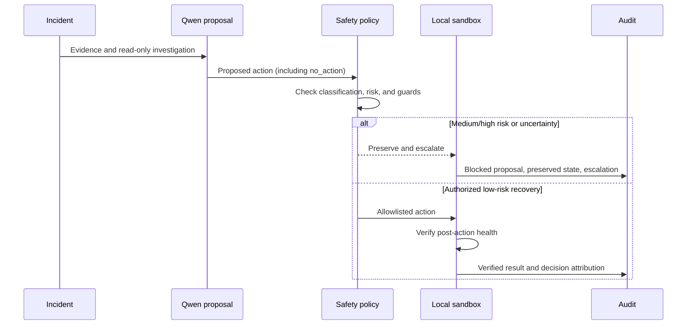

## Overview

**SANAD** (سند) investigates simulated enterprise incidents, proposes bounded recovery actions, and verifies outcomes without granting the language model direct control over infrastructure. Its central design principle is simple: **AI can recommend; independent policy decides what is safe to execute.**

The system separates evidence gathering, model-assisted investigation, deterministic risk classification, action authorization, sandbox execution, health verification, and audit logging. When evidence indicates a security concern or meaningful uncertainty, SANAD preserves evidence and escalates instead of silently ignoring the incident or attempting an unsafe repair.

> **Prototype scope:** SANAD operates on a local, file-backed incident simulator. It does **not** administer real enterprise systems, execute arbitrary LLM-generated commands, or demonstrate production-ready attack detection.

## Why SANAD?

| Design goal | Implementation |
| --- | --- |
| **Agentic investigation** | Qwen3 4B, running locally through Ollama, can choose read-only investigation tools and propose actions. |
| **Safety by construction** | Deterministic risk assessment, allowlisted operations, state guards, and escalation rules constrain proposals. |
| **Verifiable recovery** | Independent post-action health checks assess simulated service state; escalation is tracked separately from restoration. |
| **Decision accountability** | Audit traces distinguish model proposals, policy decisions, executed actions, and their sources. |
| **Reproducibility** | Seeded synthetic evaluations, frozen dataset hashes, local execution, and automated tests. |

## System architecture

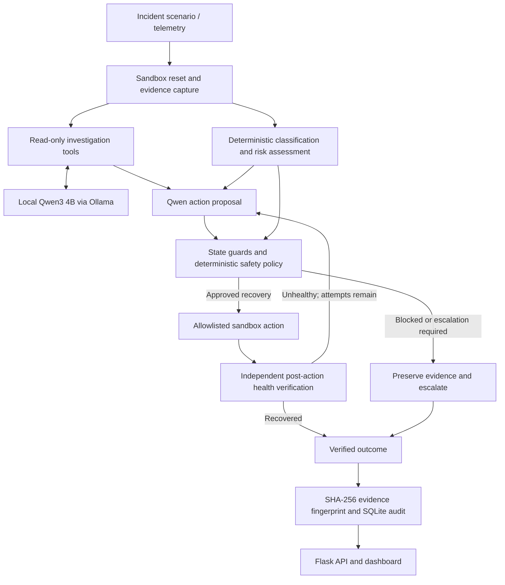

### Decision and safety workflow

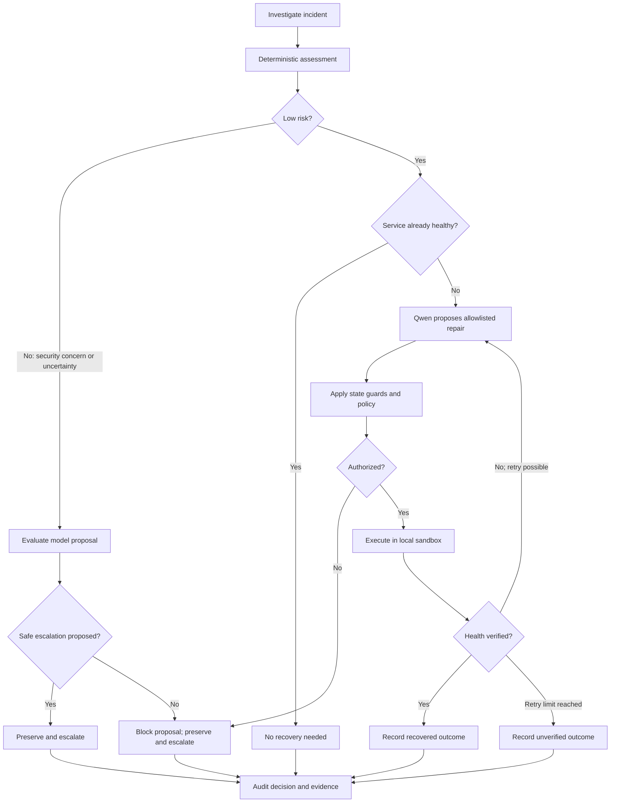

## Decision attribution

SANAD records the difference between **what the model proposed**, **what the controller authorized**, and **what actually happened**. A successful end-to-end safety outcome does not imply that the model's proposal was correct.

```mermaid
sequenceDiagram
    participant S as Incident simulator
    participant I as Investigator
    participant Q as Qwen3 / Ollama
    participant P as Deterministic policy
    participant X as Sandbox executor
    participant A as SQLite audit
    S->>I: Incident evidence and initial health
    I->>Q: Read-only investigation context
    Q-->>I: Selected inspection tools
    I->>Q: Observations and current state
    Q-->>P: Proposed action and reason
    Note over P: State guards may correct proposal
    alt Recovery authorized
        P->>X: Allowlisted action
        X-->>P: Updated health and verification
    else Blocked or escalation required
        P->>X: Preserve and escalate; no repair
        X-->>P: Escalation outcome
    end
    P->>A: Proposal source, policy decision, execution trace, hash
```

## Features

- **Local model inference:** optional Qwen3 4B integration via Ollama; explicit AI-versus-fallback attribution.
- **Read-only investigations:** health, configuration, metrics, and security observations.
- **Guarded recovery:** allowlisted simulated service, worker, queue, and configuration recovery actions.
- **Uncertainty-aware escalation:** medium/high-risk assessments prevent autonomous repair and silent `no_action` termination.
- **Closed-loop verification:** evaluates simulator health after recovery attempts.
- **Evidence and audit:** SHA-256 evidence fingerprints, execution traces, and SQLite incident history.
- **Operator dashboard:** Flask-based local UI for running registered scenarios and reviewing results.

## Getting started

### Prerequisites

- Python **3.10+**
- Ollama (optional for deterministic fallback mode; required for Qwen evaluation)
- Local resources sufficient to run `qwen3:4b`

### 1. Install dependencies

From the project root:

```bash
python3 -m venv .venv
source .venv/bin/activate
python3 -m pip install -r requirements.txt
```

### 2. Start with Qwen3 4B

Install and start [Ollama](https://ollama.com/), then:

```bash
ollama pull qwen3:4b
export SANAD_USE_OLLAMA=1
export OLLAMA_MODEL=qwen3:4b
export OLLAMA_TIMEOUT=180
python3 app.py
```

Open **http://127.0.0.1:5000** in your browser.

For deterministic fallback mode, leave `SANAD_USE_OLLAMA` unset (or set it to `0`) and run `python3 app.py`.

### 3. Run automated tests

```bash
python3 -m pytest -q
```

## Demonstration scenarios

| Scenario family | Expected controlled outcome |
| --- | --- |
| Invalid deployment configuration | Restore configuration and verify health |
| Cascading worker / queue failure | Restart worker, drain backlog, and verify health |
| Service outage | Restart simulated service and verify health |
| Suspected intrusion | Preserve evidence and escalate; no autonomous repair |
| Ambiguous incident | Preserve evidence and escalate when uncertainty warrants review |

The dashboard exposes five registered demonstration scenarios. Additional evaluation instances are exercised through internal evaluation runners, not arbitrary user-supplied production events.

## Evaluation & limitations

### Recorded live-Qwen development results — 31 October 2026

| Evaluation | Pass rate | Qwen used | Fallbacks | Safety proposal alignment | Mean latency |
| --- | ---: | ---: | ---: | ---: | ---: |
| Adversarial challenge **before** safety-gate revision | **9/12 (75%)** | 12/12 | 0 | 2/7 | 1,576.01 ms |
| Adversarial challenge **after** safety-gate revision | **12/12 (100%)** | 12/12 | 0 | 2/7 | 1,569.12 ms |
| Held-out instances **after** safety-gate revision | **20/20 (100%)** | 20/20 | 0 | 3/5 | 1,598.32 ms |

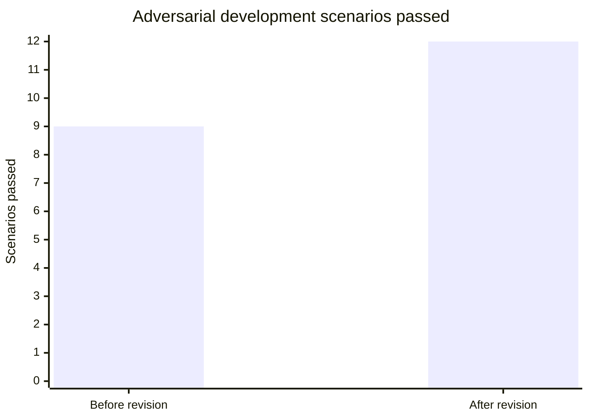

**Interpretation:** Across the two post-revision runs, SANAD achieved **32/32 expected end-to-end outcomes** with Qwen involved in all 32 and zero model fallbacks. However, Qwen's own proposals aligned with the expected safety action in only **5/12 safety-relevant cases (41.7%)**. The deterministic safety layer is therefore essential to the reported outcome.

The revision addressed a real failure mode: for some uncertain incidents, the model proposed `no_action` and the earlier policy allowed it. The revised controller enforces escalation for assessed medium/high-risk incidents. This change was made **after reviewing the adversarial failures**; the improved 12/12 is a regression result, not an independent blind evaluation.

**Dataset integrity:**

- Adversarial set SHA-256: `1c98c8e58250c8536b6fb1a7ea1c283cc00bea9e638c65f16c7b5c44bc33a6f0`
- Held-out set SHA-256: `77018674610f72cb82cc3fb4941ad1eac848feac5e1cf3ccd1c52d935dd88674`

### Reproduce the evaluations

With Ollama running and the environment variables configured as above:

```bash
python3 evaluation/run_challenge.py --require-ai
python3 evaluation/run_heldout.py --require-ai
```

Inspect the generated `summary.json`, `results.csv`, and `details.json` under the relevant evaluation result directories. See `evaluation/README.md`, `evaluation/CHALLENGE_README.md`, `EVALUATION_AUDIT.md`, and `SAFETY_GATE_CHANGELOG.md` for methodology and revisions.

### What these numbers do *not* establish

- **Not universal 100% recovery accuracy.** Cases are synthetic, and the held-out set contains instances of supported fault families, not independently unseen fault families.
- **Not 100% AI reasoning accuracy.** `AI=True` records model participation in investigation/proposal; classification, policy authorization, and state guards are deterministic.
- **Not production validation.** Recovery and health verification are performed on local simulator state.
- **Not necessarily restored service.** A verified escalation is a correctly recorded safety outcome, not proof that an unhealthy service was repaired.
- **Not a blind post-revision benchmark.** Adversarial failures informed the policy revision; some expected outcomes (including escalation for an otherwise healthy ambiguous case) merit independent ground-truth review.

## Trust boundary

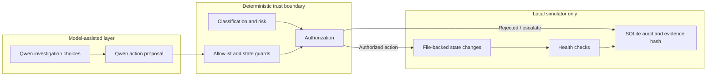

**Safety invariant:** The model never receives unrestricted command execution. Any simulated recovery must pass independent deterministic checks; security-relevant or uncertain incidents are escalated according to the current risk policy.

## API reference

| Method | Endpoint | Purpose |
| --- | --- | --- |
| `GET` | `/api/scenarios` | List registered demonstration scenarios |
| `POST` | `/api/run` | Execute a registered scenario; JSON body: `{"scenario":"<registered-id>"}` |
| `GET` | `/api/history` | Retrieve incident history |
| `GET` | `/api/history/<incident_id>` | Retrieve a specific incident's recorded details |
| `GET` | `/api/health` | Application mode and health status |
| `GET` | `/api/demo-health` | Current sandbox service health |

The Flask server binds to `127.0.0.1` by default. The API is intended for local demonstration, not exposure to an untrusted network.

## Project structure

```text
sanad-ai/
├── app.py                     # Flask API and dashboard entry point
├── sanad/
│   ├── agent.py               # Model proposal integration
│   ├── investigator.py        # Read-only investigation tools
│   ├── security.py            # Risk assessment and safety policy
│   ├── engine.py              # Recovery orchestration and audit
│   ├── sandbox.py             # Isolated simulated state
│   └── scenarios.py           # Registered demo scenarios
├── evaluation/
│   ├── heldout_cases.json     # 20 synthetic held-out instances
│   ├── challenge_cases.json   # 12 adversarial development cases
│   ├── run_heldout.py
│   └── run_challenge.py
├── tests/                     # Automated tests and safety regressions
├── templates/                 # Dashboard markup
├── static/                    # UI assets and SANAD emblem
└── requirements.txt
```

## Roadmap

- [x] Local Qwen-assisted investigation and proposals
- [x] Deterministic authorization and state guards
- [x] Evidence fingerprints and decision attribution
- [x] Synthetic held-out and adversarial regression suites
- [x] Uncertainty-aware safety-gate revision
- [ ] Independently authored unseen-family benchmark
- [ ] Ablation study: deterministic-only vs Qwen-only vs full SANAD
- [ ] Stronger model proposal alignment under uncertainty
- [ ] Production-grade integrations, access controls, and operational validation (future work)

## Project identity & credits

**SANAD | سند** is a hackathon prototype designed and developed by **Noura AlQahtani** for the **HUMAIN Future AI Builders Hackathon 2026**.

The SANAD golden falcon emblem is a custom project identity inspired by Saudi falconry heritage; it is **not** an official government emblem.

---

<div align="center">

**SANAD AI — Autonomous Recovery. Trusted by Design.**

*Built to make automated recovery more accountable, verifiable, and safety-aware.*

</div>


## Predictive & Adaptive Intelligence (Restored)

The dashboard includes a **Predictive Intelligence** tab for next-interval heuristic telemetry forecasting, incident memory, and a four-step feedback demonstration. These forecasts are advisory, not trained-model claims; the independent safety policy continues to govern all recovery actions. Endpoints: `POST /api/intelligence/analyze`, `GET /api/intelligence/memory`, `POST /api/intelligence/cycle`, `GET /api/intelligence/cycle/metrics`, and `POST /api/intelligence/mentor-cycle`.
